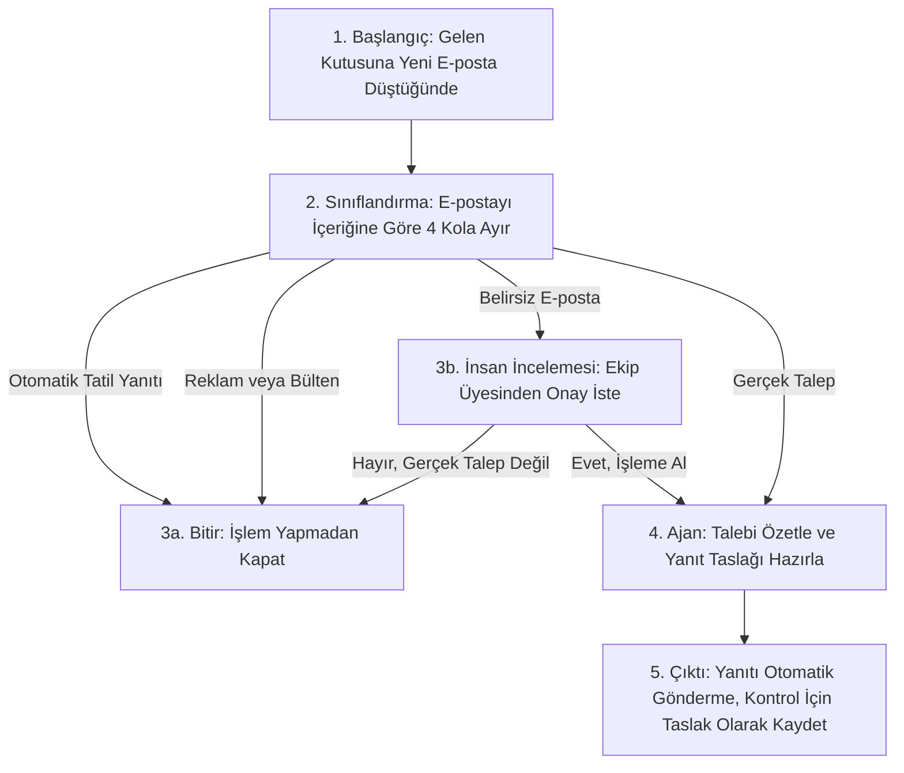

# Microsoft Copilot Studio ile E-posta Sınıflandırma ve Yanıt Taslağı İş Akışı

Ortak kurumsal posta kutularına (destek, bilgi, satın alma veya insan kaynakları) düşen e-postaları otomatik olarak inceleyen, otomatik tatil yanıtları ile reklam/bülten iletilerini eleyen ve gerçek talepler için güvenli bir **yanıt taslağı** hazırlayan 5 adımlı örnek iş akışı mimarisi.

Bu depo, karmaşık formüller veya kod satırları olmadan **hangi araçların seçileceğini**, **hangi modülden sonra hangi modülün geleceğini** ve **iş akışı tamamlandığında nasıl yürüyeceğini** Türkçe olarak adım adım göstermek için hazırlanmıştır.

---

## 1. Kimler İçin ve Hangi İş Problemini Çözer?

Birçok ekipte sabah mesai başlarken onlarca e-posta tek tek açılır:
- Yarısı otomatik tatil yanıtı, sistem bildirimi veya reklam bültenidir.
- Gerçek müşteri/iş birimi taleplerinin çoğu benzer konularla ilgilidir ancak her biri için sıfırdan yanıt yazmak ciddi zaman kaybına yol açar.

Bu mimari sayesinde ekip üyeleri gelen kutusunu tek tek ayıklamak yerine yalnızca **hazırlanmış yanıt taslaklarını gözden geçirip onaylamaya** odaklanır.

---

## 2. Kullanılan Araçlar ve Modüller

Bu senaryoda yalnızca iki temel araç birlikte çalışır:

| Sıra | Araç | Modül / Görev | Ne İşe Yarar? |
|---|---|---|---|
| 1 | **Microsoft Outlook (Office 365)** | E-posta Geldiğinde Tetikleyicisi (`When a new email arrives`) | Gelen kutusuna yeni bir e-posta düştüğü anda iş akışını başlatır. |
| 2 | **Copilot Studio İş Akışları** | Yapay Zekâ Sınıflandırma Modülü (`Classify`) | E-postanın konusunu ve içeriğini okur; Gerçek Talep, Tatil Yanıtı, Bülten veya Belirsiz olarak 4 kola ayırır. |
| 3 | **Copilot Studio İş Akışları** | Bitir (`End`), İnsan İncelemesi (`Human review`) ve Koşul (`If/Else`) | Gereksiz tatil yanıtı ve bültenleri durdurur; emin olunmayan e-postaları ekip üyesinin onayına sorar. |
| 4 | **Copilot Studio** | Ajan Modülü (`Agent`) | Yalnızca gerçek taleplerde devreye girer; kurumsal bilgi ve kurallara göre özet ve yanıt taslağı yazar. |
| 5 | **Microsoft Outlook (Office 365)** | Taslak / İnceleme E-postası Modülü (`Draft` / `Send an email`) | Üretilen yanıtı dış alıcıya otomatik göndermek yerine insan kontrolü için taslak veya iç bildirim olarak kaydeder. |

---

## 3. Genel İş Akışı ve Mimari Şeması

---

## 4. Depo Klasör ve Dosya Yapısı

| Dosya / Klasör | Açıklama |
|---|---|
| `README.md` | Projenin genel tanıtımı, araç özeti, akış şeması ve adım adım kurulum rehberi. |
| `genel-akis-semasi.md` | Modüller arası geçiş mantığı ve iş akışı tamamlandığında uçtan uca nasıl çalıştığının detaylı Türkçe özeti. |
| `eposta-yanit-asistani/SKILL.md` | İş akışındaki ajan modülüne yüklenebilecek, e-postayı güvenli biçimde analiz edip kurumsal dille yanıt taslağı çıkaran Türkçe yetenek dosyası. |

---

## 5. Adım Adım Kurulum ve Uygulama Rehberi

1. Copilot Studio üzerinde **İş Akışları** (`Workflows`) bölümünü açın ve yeni bir iş akışı oluşturun.
2. Başlangıç noktasına **Microsoft Outlook** üzerinden yeni e-posta geldiğinde çalışan tetikleyici modülünü ekleyin.
3. Tetikleyicinin hemen ardına **Sınıflandırma** (`Classify`) modülünü bağlayın ve dört dal tanımlayın: Gerçek Talep, Otomatik Tatil Yanıtı, Bülten ve Belirsiz.
4. Tatil yanıtı ile bülten dallarını **Bitir** (`End`) modülüyle kapatın; belirsiz dalın arkasına **İnsan İncelemesi** (`Human review`) ve koşul modülünü yerleştirin.
5. Gerçek talep dalına **Ajan** (`Agent`) modülünü ekleyin ve bu depodaki `eposta-yanit-asistani/SKILL.md` kurallarını tanımlayın.
6. Akışın en sonuna **Microsoft Outlook** e-posta/taslak modülünü koyarak hazırlanan metnin kontrol için taslak veya iç onay e-postası olarak kaydedilmesini sağlayın.

---

## 6. Kurumsal Veri Güvenliği ve Yönetişim Notu

- **İnsan onayı esastır:** Yapay zekâ dış müşteriye veya tedarikçiye doğrudan otomatik e-posta göndermez; her yanıt taslağı ekip üyesinin onayına sunulur.
- **Kurumsal sınırlar:** Copilot Studio üzerinde çalışan bu iş akışı, kurumunuzun Microsoft 365 güvenlik ve uyumluluk sınırları içinde yürütülür; kurumsal e-posta verileri dış modelleri eğitmek için kullanılmaz.

---

## 7. Türkçe Açıklamalı Resmî Kaynaklar

- **Copilot Studio İş Akışları Genel Bakış:** Görsel iş akışı tuvalinin çalışma mantığı ve temel düğüm yapısı — https://learn.microsoft.com/en-us/microsoft-copilot-studio/workflows-experience/flows-overview
- **İş Akışı İçinde Ajan Modülü Kullanımı:** İş akışı adımları arasında yapay zekâ ajanının nasıl çağrıldığı — https://learn.microsoft.com/en-us/microsoft-copilot-studio/workflows-experience/flow-agent
- **Microsoft Outlook (Office 365) Bağlayıcısı:** E-posta tetikleyicisi, taslak oluşturma ve e-posta aksiyonları — https://learn.microsoft.com/en-us/connectors/office365/
- **Copilot Studio Veri Gizliliği ve Güvenlik Sınırları:** Kurumsal veri güvenliği, uyumluluk ve model eğitiminden muafiyet ilkeleri — https://learn.microsoft.com/en-us/microsoft-copilot-studio/agents-experience/overview

---

## 8. Hazırlayan

**Eren Bostan**  
Microsoft Copilot Studio ile günlük iş süreçlerinde doğrudan uygulanabilen Türkçe kurumsal yapay zekâ ajanları ve iş akışı mimarileri üzerine eğitim içerikleri üretmektedir.
