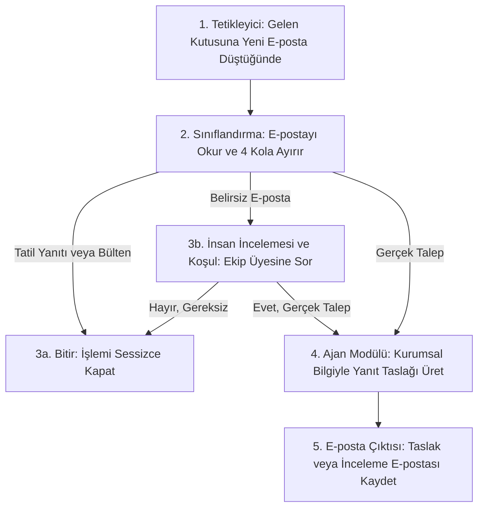

# Genel İş Akışı Şeması ve Modül Sırası

Karmaşık ayar veya kod ifadeleri olmadan iş akışının tuvaldeki genel dizilimi şu şekildedir:

## Akış Tamamlandığında Uçtan Uca Nasıl Yürür?

1. **Tetikleme:** Ortak gelen kutusuna düşen her yeni e-posta iş akışını otomatik olarak başlatır.
2. **Sessiz Eleme:** Sınıflandırma modülü e-postanın amacını anlayarak gereksiz otomatik tatil yanıtlarını ve reklam/bültenleri daha en başta işlem harcamadan durdurur.
3. **İnsan Onayı:** Akışın emin olamadığı belirsiz e-postalar ekip üyesine sorulur; onay verilirse bir sonraki adıma geçer.
4. **Taslak Hazırlama:** Yalnızca gerçek talepler ajan modülüne ulaşır; ajan gelen mesajı özetler ve kurumsal politikalara uygun yanıt taslağını yazar.
5. **Güvenli Çıktı:** Son adımdaki e-posta modülü, üretilen yanıtı dış alıcıya doğrudan göndermeyip insan kontrolü için taslak veya ekip içi inceleme mesajı olarak kaydeder.

---
**Hazırlayan:** Eren Bostan
